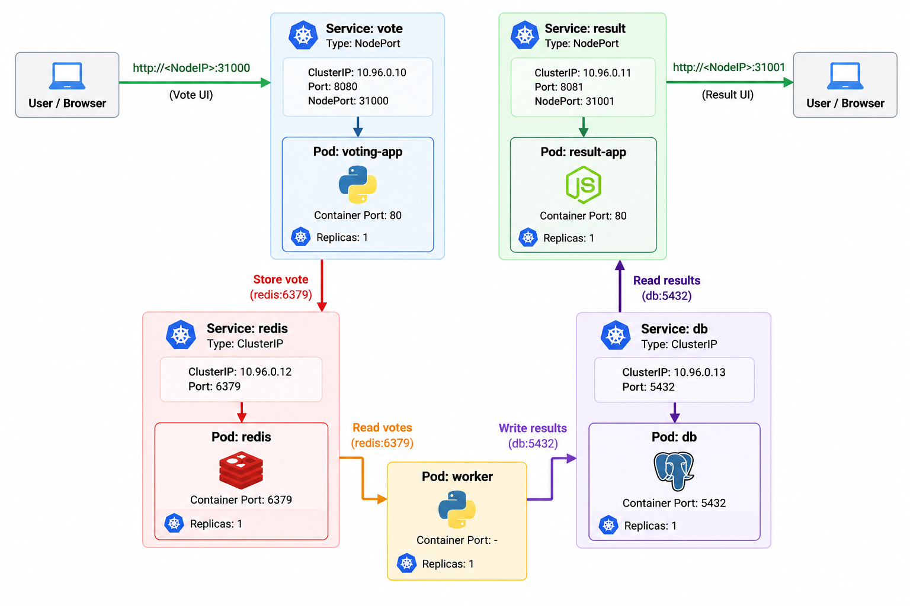
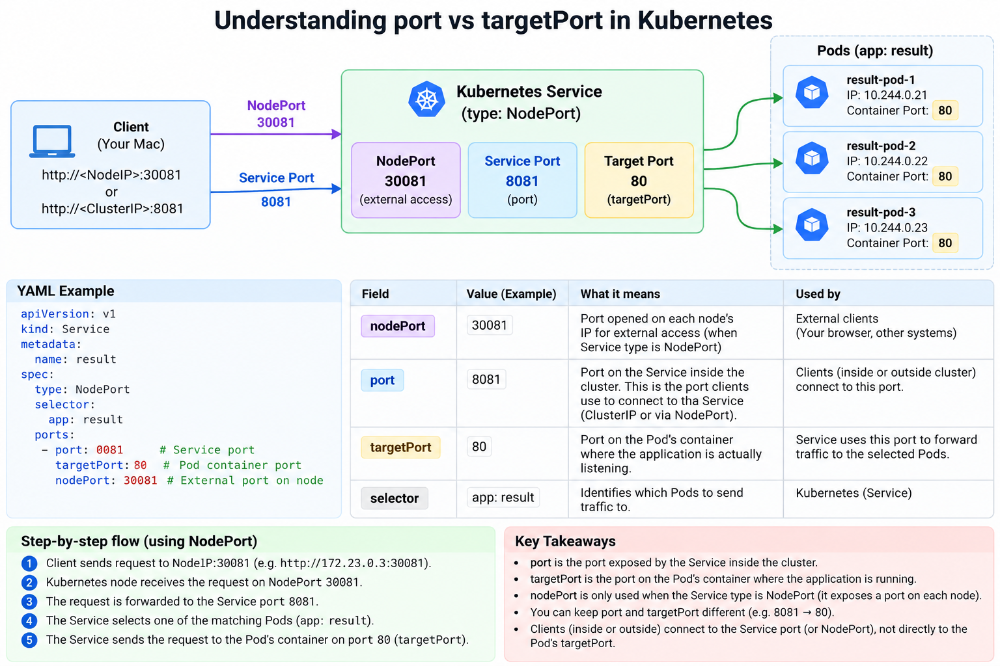

### Workflow

- User votes using voting-app
- voting-app update redis with the count
- Worker gets the count from redis and update the postgres db
- User checks results using result-app. result-app get the results from postgres db to show on UI

### Architecture diagram

### Node port explained

